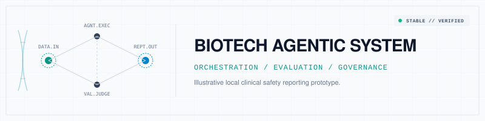

<p align="center">
  
</p>

# AegisCSR

**Deterministic clinical safety narrative drafts, local and LLM-free.**


AegisCSR transforms structured clinical records and selected note findings into
source-grounded narrative drafts. Both execution engines use the same typed state,
nodes, routing, failure boundaries, and terminal approval logic. No model APIs,
network data connectors, persistence, or external telemetry are configured.

## Quick start

Requires Python 3.10 or later. Use fictional data only.

```bash
python -m venv .venv
source .venv/bin/activate
python -m pip install -r requirements.txt
python -m src.main --config config/runtime.json
python -m unittest discover -s tests -v
```

Optional LangGraph execution:

```bash
python -m pip install -r requirements-langgraph.txt
```

`config/runtime.json` is loaded only when passed with `--config`. Settings are
`engine` (`auto`, `native`, `langgraph`), `max_writer_passes` (positive integer),
and `min_compliance_score` (finite number in `(0, 1]`). Defaults match that file.
`auto` chooses LangGraph if installed; only missing optional dependencies trigger
native fallback. Compile or node errors never silently switch engines.

## Pipeline

```text
Validated raw record -> Local de-identification gateway
    -> Extractor -> Writer -> QC -> Finalize -> Local subject-ID restoration
                      ^       |
                      +-------+ (bounded rewrite)
```

The gateway recursively removes selected identifiers, scrubs supplied identifier
values and name components from string fields, redacts common email/phone/SSN
patterns, groups numeric ages over 89 as `90+`, and tokenizes subject IDs. Random
128-bit tokens are owned by an invocation-local, locked vault. Originals are
encrypted in memory; lookup keys are keyed digests, not plaintext identifiers.
The vault is cleared on success or failure.

The output narrative **contains restored subject IDs** and must remain inside a
trusted local boundary. Other returned state fields remain pseudonymized. Token
randomness is intentional; clinical findings, transitions, scores, and restored
narratives are deterministic for the same validated inputs and settings.

Extraction uses precompiled whole-word rules, conservative clause-level negation
and uncertainty handling, and inclusive ALT `>= 3x ULN` / bilirubin `>= 2x ULN`
thresholds. It does not infer drug-induced liver injury from these values.
Missing information is marked as not reported rather than invented.

CSV ingestion streams one row at a time using the standard library, preserves
leading zeros, literal `NA`, and empty strings, and rejects malformed rows and
duplicate headers. `iter_subject_records()` streams matching records;
`fetch_subject_records()` intentionally collects that subject's events.

## Scope and limitations

This is hardened engineering groundwork, **not a validated production clinical
system**. Automated `is_approved` means only that the configured QC checks passed;
it is not human approval or a regulatory compliance decision.

Selected-field and regex redaction is **not comprehensive HIPAA Safe Harbor
de-identification**. Unknown names, dates, locations, images, unusual phone
formats, quasi-identifiers, and other free-text PHI may remain. Tokenization is
reversible pseudonymization, not anonymization. Python does not guarantee secure
memory erasure. Do not enter real patient information.

Text rules are illustrative, not licensed MedDRA coding or diagnostic inference.
Negation handling is deliberately conservative and can miss findings in complex
clauses. Peak laboratory values alone cannot establish temporally related
clinical syndromes. Clinical validation, access controls, secure deployment,
human review, audit trails, signatures, and operational governance remain outside
the implemented scope. Deployment must enforce network egress restrictions;
application-local execution alone is not an operating-system air gap.

## Repository layout

```text
config/runtime.json             Validated local runtime settings
src/runtime.py                  Configuration contract and loader
src/main.py                     Fictional local demonstration
src/agents/state.py             Typed clinical, workflow, and node-update schemas
src/agents/graph.py              Shared transitions and dual execution engines
src/agents/nodes/                Extraction, source-grounded drafting, and QC
src/agents/utils/                Privacy gateway, CSV, validation, phenotyping
tests/                          unittest coverage for both engines and utilities
requirements.txt                Minimal local runtime
requirements-langgraph.txt      Optional LangGraph runtime
```

## Public sample data

The [SafetyGraphics `safetyData` package](https://github.com/SafetyGraphics/safetyData)
provides PHUSE sample CDISC SDTM and ADaM datasets; its README states the PHUSE
data are MIT licensed. Review upstream licensing and attribution before
redistribution. Data are not bundled or fetched by this application.

To export a subject-level example from R:

```r
install.packages("safetyData")
adsl <- safetyData::adam_adsl
names(adsl)[names(adsl) == "USUBJID"] <- "subject_id"
write.csv(adsl, "adsl.csv", row.names = FALSE)
```

CSV rows remain strings. Callers must explicitly map demographics, events, and
laboratory values into the validated clinical record schema; the parser does not
join ADSL, ADAE, and ADLB or read SAS XPT.

## Who might find this useful?

Teams exploring clinical-trial safety workflows, pharmacovigilance, and narrative
automation may find this a transparent starting point. Possible audiences include
biopharma organizations such as Pfizer, Roche, Novartis, AstraZeneca, Merck, Amgen,
Gilead Sciences, Moderna, and Regeneron, and clinical research organizations such
as IQVIA, ICON, Parexel, Fortrea, and Labcorp.

These are examples of organizations in the broader life-sciences space—not
customers, users, or endorsers of this project.

## Documentation

- [Scenario and intended use](docs/business_scenario.md)
- [System architecture](docs/system_architecture.md)
- [Security and regulatory considerations](docs/compliance_governance.md)
- [Evaluation approach](docs/evaluation_observability.md)
